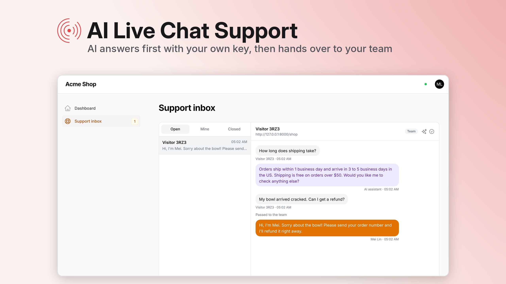
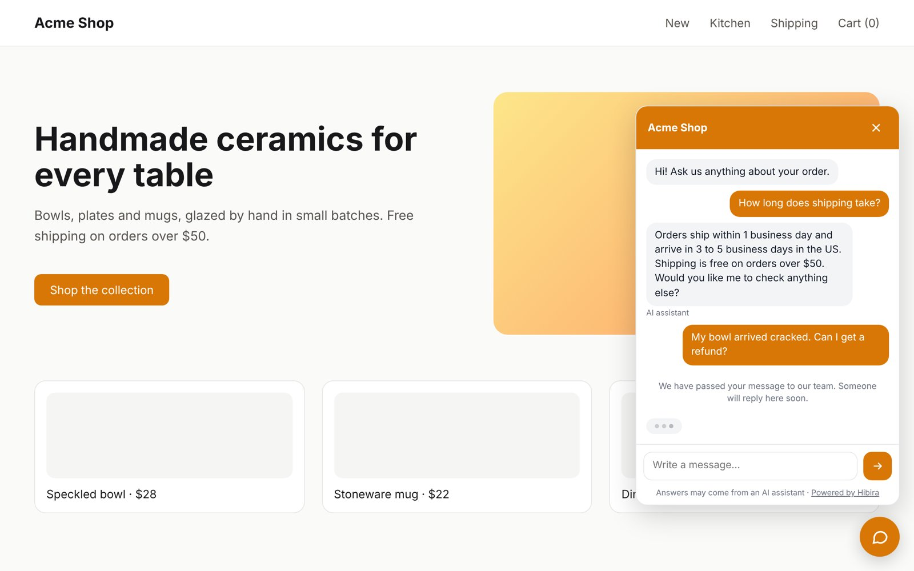
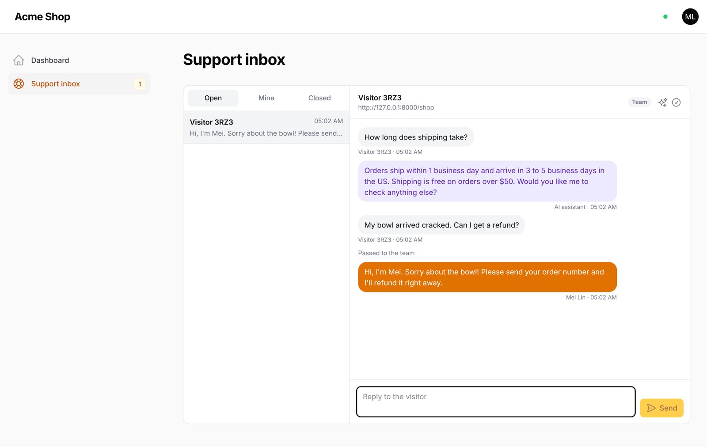

# hibira-io/filament-support



[](https://github.com/hibira-io/filament-support/actions/workflows/ci.yml)

AI live chat support for [Filament](https://filamentphp.com), on
[Hibira](https://hibira.io).

Put a chat on your website with one script tag. An AI answers visitors
first, with **your own API key**, from the knowledge you give it. When it is
not sure, or the visitor asks for a person, the chat goes to your team, who
answer from a live inbox in your Filament panel.

- **Chat widget** for any website, Laravel or not. Messages arrive the moment
  they are sent, over Hibira.
- **Support inbox** in your panel: conversations update live, with an unread
  badge and a notification anywhere in the panel when a visitor needs you.
- **Bring your own AI**: OpenAI, Anthropic (Claude), Google Gemini, OpenRouter,
  DeepSeek, or any OpenAI-compatible service such as Ollama. The key is stored
  encrypted in your database and calls go straight from your server to the
  provider.
- **Three AI modes**: off, suggested replies your team checks and sends, or
  automatic answers.
- **Hands over to a person** when the AI is not sure, when the visitor asks
  for one, and for refunds, payments, legal and security questions. Once
  someone on your team replies, the AI stays out of that conversation.
- **Keeps your AI bill in check** with limits per conversation, per visitor
  and per day.
- In English, 繁體中文, 简体中文, 日本語, 한국어, ไทย and Tiếng Việt.

Supports Filament 3, 4 and 5. Conversations are stored in your own database;
Hibira only delivers them live.

## Screenshots

The chat on your website: the AI answers, then hands a refund question to your team.



The support inbox in your Filament panel, live.



## Install

```sh
composer require hibira-io/filament-support
php artisan hibira:install
php artisan migrate
```

`hibira:install` (from [hibira-io/laravel](https://github.com/hibira-io/laravel))
adds the `HIBIRA_*` settings to `.env`. Copy the app ID, key and secret from
your app page on [hibira.io/portal](https://hibira.io/portal) (the free plan
needs no card), and check them with `php artisan hibira:check`.

Add both plugins to your panel. `HibiraPlugin` from
[hibira-io/filament](https://github.com/hibira-io/filament) connects the
panel to Hibira; `HibiraSupportPlugin` adds the inbox.

```php
use Hibira\Filament\HibiraPlugin;
use Hibira\FilamentSupport\HibiraSupportPlugin;

public function panel(Panel $panel): Panel
{
    return $panel
        // ...
        ->plugins([
            HibiraPlugin::make(),
            HibiraSupportPlugin::make(),
        ]);
}
```

Then open **Support inbox → Set up AI** in your panel, choose a provider,
paste your API key and your FAQ, and try a question.

## Add the chat to your website

In a Blade layout of the same Laravel app:

```blade
<x-hibira-support::widget />
```

On any other site, paste this before `</body>`, with your app's URL:

```html
<script src="https://your-app.example/hibira-support/widget.js" async></script>
```

For signed-in customers you can pass their name and email, so your team sees
who they are:

```html
<script src="https://your-app.example/hibira-support/widget.js" data-name="Ada" data-email="ada@example.com" async></script>
```

When the website is on a different domain from your Laravel app, allow it in
two places:

1. `.env`: `HIBIRA_SUPPORT_ORIGINS=https://www.example.com,https://example.com`
2. Your Hibira app page → **Allowed origins**: the same sites.

## Options

```php
HibiraSupportPlugin::make()
    // Who may answer visitors (default: everyone who can use the panel).
    ->authorize(fn (User $user) => $user->is_support)
    // Who may change the AI settings and the API key (default: same as above).
    ->authorizeSettings(fn (User $user) => $user->is_admin)
    ->navigationGroup('Support')
    ->navigationSort(2)
    // Turn off the in-panel notification when a visitor needs the team.
    ->toasts(false);
```

Publish the config to change the URL path, the limits on AI answers, or to
hide the "Powered by Hibira" link:

```sh
php artisan vendor:publish --tag=hibira-support-config
```

| Setting | Default |
| --- | --- |
| `limits.ai_replies_per_conversation` | 8 |
| `limits.ai_replies_per_ip_per_10_minutes` | 6 |
| `limits.ai_replies_per_ip_per_day` | 30 |
| `limits.conversations_per_ip_per_hour` | 10 |
| `limits.messages_per_minute` | 20 |
| `powered_by` (`HIBIRA_SUPPORT_POWERED_BY`) | `true` |

The daily cap on AI answers is set on the settings page.

## Queues

AI answers run in a queued job. With a queue worker running they wait two
seconds, so several quick messages get one answer. Without one
(`QUEUE_CONNECTION=sync`) they run right after the visitor's request is
answered.

## How it uses Hibira

- Each conversation has its own private channel. The visitor's browser is
  allowed onto it with the conversation's token, which only that browser
  has.
- The inbox listens on a private channel that only panel users can join.
- Events carry the message when it fits in Hibira's message size limit, and
  otherwise just its ID, so the browser fetches it.
- If the connection drops, the widget and the inbox fall back to polling.

## Testing

```sh
composer test
```

## License

MIT
